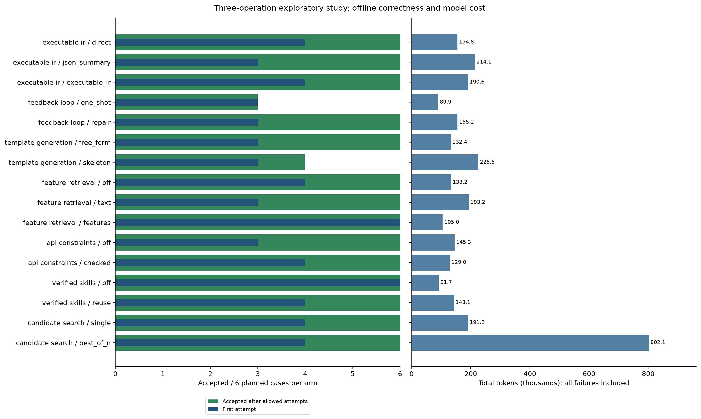

# Seven-direction study: results and interpretation

**91/96 planned evaluation cases passed offline validation.** 0 exhausted the token budget. The evaluation recorded **3,096,227 tokens**; new pilot/seed work recorded another **103,513 tokens**.

A pass means the emitted artifact compiled for AMD NPU2 and its supported host/dataflow execution matched an independent numerical oracle. Physical NPU execution, speed, vectorization, and power were not measured.

- **Repair versus one-shot:** 6/6 versus 3/6 accepted cases.
- **Four-candidate search versus one candidate:** 6/6 versus 6/6, using **4.20x** the recorded model tokens.
- **Original skeleton prompt:** 4/6 accepted. Read the GEMV capability follow-up separately; it does not replace the frozen results.

## Why this rerun differs from the original

The original add-only run passed 1/16 arms; 14 exhausted 100,000 tokens. Its dominant failure was incompatible IRON API usage. This revision supplies the existing pinned-toolchain transport/API guidance to every free-form arm, retains earlier errors in compact repair feedback, and generates all initial search candidates before repairing them. Numerical tolerances and acceptance gates were not relaxed.

The ceiling is now 200,000 tokens per case, equally across arms, to accommodate four independent IR-plus-code candidates. Cached input and reasoning tokens remain included in input + output usage without double counting. A call can cross the ceiling; that response is charged and not evaluated. These counts are not a dollar bill. Changes to guidance, budget, tasks, and libraries make the old/new comparison a recovery check, not a causal estimate of any single fix.

## Frozen evaluation design

| Operation | Verified seed shape | Evaluation shape | Repetitions per arm |
| --- | --- | --- | ---: |
| add | [64] | [128] | 2 |
| reduce | [64] | [128] | 2 |
| gemv | [8, 16] | [16, 32] | 2 |

Model: `gpt-5.6-terra`, reasoning `xhigh`; up to five repairs; best-of-N has four candidates. Every arm sees the same evaluation input, compiler, numerical tolerance, and token ceiling for its task. The three operation suites run sequentially, with seven directions concurrent within each suite. The reduction and addition sources come from the classic corpus with smaller static shapes. GEMV uses the study-authored float32 CUDA loop stored with the inputs.

The evaluator uses the existing twelve public input families per backend attempt. Search also checks five private random inputs plus a metamorphic input against both the executable IR and the independent reference. Repetitions vary model generation; they use the same frozen numerical test seeds and are not additional independent benchmark tasks.

The frozen library contains **3 verified seed entries**, from smaller shapes in the same operation families. Each case receives a private copy; evaluation results cannot leak into later cases. The earlier add skeleton is reused as one seed, with its original evidence preserved. Seed construction cost is separated from evaluation cost.

## Results by arm



| Direction / arm | Accepted / planned | First attempt | Add | Reduction | GEMV | Total tokens |
| --- | ---: | ---: | ---: | ---: | ---: | ---: |
| executable_ir / direct | 6/6 | 4/6 | 2/2 | 2/2 | 2/2 | 154,805 |
| executable_ir / json_summary | 6/6 | 3/6 | 2/2 | 2/2 | 2/2 | 214,103 |
| executable_ir / executable_ir | 6/6 | 4/6 | 2/2 | 2/2 | 2/2 | 190,563 |
| feedback_loop / one_shot | 3/6 | 3/6 | 1/2 | 1/2 | 1/2 | 89,862 |
| feedback_loop / repair | 6/6 | 3/6 | 2/2 | 2/2 | 2/2 | 155,234 |
| template_generation / free_form | 6/6 | 3/6 | 2/2 | 2/2 | 2/2 | 132,421 |
| template_generation / skeleton | 4/6 | 3/6 | 2/2 | 2/2 | 0/2 | 225,477 |
| feature_retrieval / off | 6/6 | 4/6 | 2/2 | 2/2 | 2/2 | 133,216 |
| feature_retrieval / text | 6/6 | 3/6 | 2/2 | 2/2 | 2/2 | 193,161 |
| feature_retrieval / features | 6/6 | 6/6 | 2/2 | 2/2 | 2/2 | 105,009 |
| api_constraints / off | 6/6 | 3/6 | 2/2 | 2/2 | 2/2 | 145,301 |
| api_constraints / checked | 6/6 | 4/6 | 2/2 | 2/2 | 2/2 | 129,025 |
| verified_skills / off | 6/6 | 6/6 | 2/2 | 2/2 | 2/2 | 91,691 |
| verified_skills / reuse | 6/6 | 4/6 | 2/2 | 2/2 | 2/2 | 143,102 |
| candidate_search / single | 6/6 | 4/6 | 2/2 | 2/2 | 2/2 | 191,156 |
| candidate_search / best_of_n | 6/6 | 4/6 | 2/2 | 2/2 | 2/2 | 802,101 |

The six controls `executable_ir/direct`, `feedback_loop/repair`, `template_generation/free_form`, `feature_retrieval/off`, `api_constraints/off`, and `verified_skills/off` use the same guided repair algorithm. Their individual differences are repeated-run variation, not six distinct methods. Pooled descriptively, these controls accepted **36/36** cases, with **23** first-attempt passes.

Among arms passing every planned case, **verified_skills / off** used the fewest recorded tokens (91,691). This is a repeated guided-repair control; its low sample cost does not identify a separate better algorithm.

## What each comparison can tell us

### Executable ir

`direct` 6/6 accepted, 4 first-attempt, 154,805 tokens; `json_summary` 6/6 accepted, 3 first-attempt, 214,103 tokens; `executable_ir` 6/6 accepted, 4 first-attempt, 190,563 tokens.

Against `direct`, `json_summary` accepted the same number of cases and used 1.38 times the recorded tokens. Against `direct`, `executable_ir` accepted the same number of cases and used 1.23 times the recorded tokens.

Compare semantic-pivot success and its extra token cost. A passing IR is not sufficient for backend acceptance.

### Feedback loop

`one_shot` 3/6 accepted, 3 first-attempt, 89,862 tokens; `repair` 6/6 accepted, 3 first-attempt, 155,234 tokens.

Against `one_shot`, `repair` accepted 3 more cases and used 1.73 times the recorded tokens.

The observed acceptance difference favors bounded repair on these tasks. The two arms use separate model generations; this is not a matched replay of identical first drafts.

### Template generation

`free_form` 6/6 accepted, 3 first-attempt, 132,421 tokens; `skeleton` 4/6 accepted, 3 first-attempt, 225,477 tokens.

Against `free_form`, `skeleton` accepted 2 fewer cases and used 1.70 times the recorded tokens.

Compare fixed transport against generated transport. This is an offline correctness/cost comparison; it cannot establish a vectorization advantage.

### Feature retrieval

`off` 6/6 accepted, 4 first-attempt, 133,216 tokens; `text` 6/6 accepted, 3 first-attempt, 193,161 tokens; `features` 6/6 accepted, 6 first-attempt, 105,009 tokens.

Against `off`, `text` accepted the same number of cases and used 1.45 times the recorded tokens. Against `off`, `features` accepted the same number of cases and used 0.79 times the recorded tokens.

Compare off, text, and feature selection from the same nonempty frozen library. With only three seed entries, broad retrieval superiority remains untested.

### Api constraints

`off` 6/6 accepted, 3 first-attempt, 145,301 tokens; `checked` 6/6 accepted, 4 first-attempt, 129,025 tokens.

Against `off`, `checked` accepted the same number of cases and used 0.89 times the recorded tokens.

Compare import/symbol checking with no checking under shared API guidance. This is post-generation lint, not full grammar-constrained decoding.

### Verified skills

`off` 6/6 accepted, 6 first-attempt, 91,691 tokens; `reuse` 6/6 accepted, 4 first-attempt, 143,102 tokens.

Against `off`, `reuse` accepted the same number of cases and used 1.56 times the recorded tokens.

Compare reuse of earlier verified kernels with no reuse on new shapes. Reuse uses the same inference-time selector as feature_retrieval/features; their differences are repeated-run variation. This measures transfer from verified experience; the fixed library does not measure a long-term growth curve.

### Candidate search

`single` 6/6 accepted, 4 first-attempt, 191,156 tokens; `best_of_n` 6/6 accepted, 4 first-attempt, 802,101 tokens.

Against `single`, `best_of_n` accepted the same number of cases and used 4.20 times the recorded tokens.

Compare one candidate with four independently generated candidates using private numerical, differential-IR, and metamorphic selection. Private tests are selection data, not a final untouched benchmark.

## Coverage and unresolved failures

- Status counts: `{'completed': 91, 'failed': 5}`; all 96 planned cases remain in the denominator.
- Best-of-N cases generating all four bundles: 6/6.
- Best-of-N cases with four distinct final code bundles: 6/6 (textual diversity, not proof of distinct performance strategies).
- Search cases with at least one private-selection pass before repairs: single 4/6; best-of-N 6/6. The first-attempt column above counts only the first candidate, not the entire initial population.
- Retrieval/reuse cases with at least one retrieved example: 18/18.
- Attempts failing design emission: 3.
- Cases exceeding the accounted token ceiling: 0.
- Cases with complete accounting using at most the original 100,000-token ceiling: 90/96. This is recorded consumption, not a replay under the old stopping rule.
- Missing token accounting: 0 cases.
- Sum of sequential suite wall times: 61.4 minutes. Overlapping child active times are not added to this clock; pilot and setup time are separate.

Failed attempts, counted once at their first reported failed stage (including attempts later repaired):

| First failing stage | Attempts |
| --- | ---: |
| target_compile | 50 |
| host_execution (unsupported) | 4 |
| design_emission | 3 |

Some target-compiled candidates could not be evaluated by the supported host simulator. They remain unaccepted; unsupported validation is not proof that their arithmetic is wrong. In GEMV, generated `aie::mul`/`aie::mac` code exposes this coverage limit.

The target compiler frontend crashed on **5 generated candidates**. These are compiler failures on the recorded source, not numerical-test failures. The pinned toolchain and acceptance policy were retained.

- [add/feedback_loop--one_shot--r2](../suite-add/cases/feedback_loop--one_shot--r2/report.json): **failed**. target_compile (failed): error: "-":13:22: expected SSA operand
- [reduce/feedback_loop--one_shot--r1](../suite-reduce/cases/feedback_loop--one_shot--r1/report.json): **failed**. target_compile (failed): error: "-":12:22: expected SSA operand
- [gemv/feedback_loop--one_shot--r2](../suite-gemv/cases/feedback_loop--one_shot--r2/report.json): **failed**. target_compile (failed): /work/candidate/design.mlir:33:9: error: 'aie.dma_bd' op Buffer descriptor length does not match length of transfer expressed by lowest three dimensions of data layout transformation strides/wraps. BD length is 2048 bytes. Lowest three dimensions of data layout transformation would result in transfer of 128 bytes.
- [gemv/template_generation--skeleton--r1](../suite-gemv/cases/template_generation--skeleton--r1/report.json): **failed**. target_compile (failed): clang++: error: clang frontend command failed with exit code 70 (use -v to see invocation)
- [gemv/template_generation--skeleton--r2](../suite-gemv/cases/template_generation--skeleton--r2/report.json): **failed**. host_execution (unsupported): unsupported intrinsic: ['mul']

## Pilot and seed ledger

| Run | Outcome | Recorded tokens |
| --- | --- | ---: |
| [pilot-direct-add](../pilot-direct-add/report.json) | completed | 30,359 |
| [seed-gemv](../seed-gemv/report.json) | blocked | 0 |
| [seed-gemv-v2](../seed-gemv-v2/report.json) | completed | 35,769 |
| [seed-reduce](../seed-reduce/report.json) | completed | 37,385 |

The initial GEMV seed attempt stopped before generation because the oracle does not bind arbitrary rows/cols scalars. Its corrected input uses explicit static dimensions; the blocked record is retained. Historical add-seed usage belongs to the original run and is not charged again here.

## Separate GEMV capability-guidance follow-up

The frozen study exposed a gap in the skeleton prompt: it encouraged vector operations without listing the host evaluator's supported compute subset. Revision `guided-compute-v3` adds that subset and requests scalar pointer loops for unsupported multiply/dot operations, avoiding nonportable vector operators and dynamic lane indexing. The compiler, numerical tolerances, reference, and acceptance policy stay the same.

**This is a development replay on the same GEMV shape, not a new held-out benchmark.** Its four predeclared cases are separate from the 96-case table; original failures are retained.

| Arm / repetition | Outcome | First attempt | Attempts | Tokens |
| --- | --- | --- | ---: | ---: |
| [free_form--r1](../gemv-capability-followup/cases/free_form--r1/report.json) | completed | yes | 1 | 16,205 |
| [skeleton--r1](../gemv-capability-followup/cases/skeleton--r1/report.json) | completed | yes | 1 | 10,298 |
| [free_form--r2](../gemv-capability-followup/cases/free_form--r2/report.json) | completed | yes | 1 | 14,573 |
| [skeleton--r2](../gemv-capability-followup/cases/skeleton--r2/report.json) | completed | yes | 1 | 10,349 |

Follow-up total: **4/4 accepted**, **51,425 additional recorded tokens**. A passing scalar fallback establishes offline correctness, not vectorization or device speed.

* Incomplete usage: displayed token counts are known usage only.

The follow-up plan and commands remain with the original local run directory.

For GEMV skeletons specifically, the original prompt accepted **0/2** cases using **171,248 tokens**. The corrected prompt accepted **2/2**, with **2 first-attempt passes** and **20,647 tokens**. Treat this as evidence for the targeted portability fix on the replayed shape.

## How to use these results

Keep guided repair as the default for this task family. Four-candidate search added no final accepted cases here, so reserve that extra token cost for harder cases. Use the corrected compute-capability guidance when trying skeletons; do not interpret a scalar fallback as a vectorization or device-performance improvement. Feature retrieval is promising for first-draft reliability in its six runs, but the identical skill-reuse selector varied and the library is small.

Use accepted count first, then first-attempt count and total tokens to choose the next exploratory pipeline. Equal acceptance with more tokens is no observed correctness benefit on this cohort. There are only three small operation families and two repetitions per arm: report descriptive differences, not statistical significance or general NPU superiority. Larger workloads, different operations, physical-device performance, and direct CUDA equivalence remain untested. Skeleton selection and feature retrieval use the reviewed manifest operation labels; this study does not measure automatic operation classification from arbitrary CUDA source.

## Evidence and reproduction

This handoff includes derived results; detailed case links require the original local run directory.

- [Frozen protocol](../protocol.json) and [machine-readable summary](summary.json).
- [Evidence audit](../validation-audit.json): frozen code, compiler identity, inputs, and complete token accounting.
- [add detailed report](../suite-add/results/REPORT.md), including every child log and evidence bundle.
- [reduce detailed report](../suite-reduce/results/REPORT.md), including every child log and evidence bundle.
- [gemv detailed report](../suite-gemv/results/REPORT.md), including every child log and evidence bundle.

Regenerate this report from the original local run directory without model calls:

```bash
.venv/bin/python -m bucketed_length.report_study runs/bucketed-length/guided-study-20261001
```
